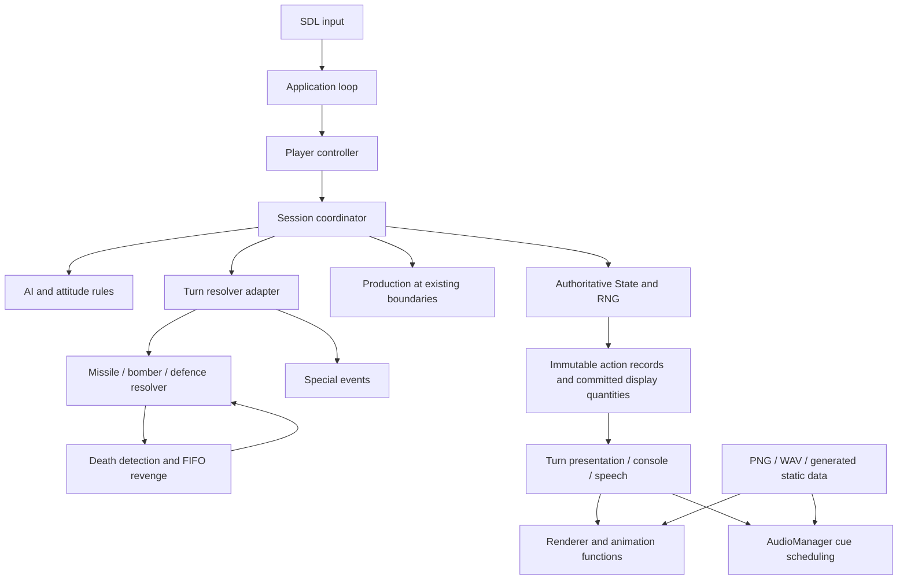

# Architecture

The game retains the completed reconstruction's algorithms. Organization,
formatting, asset representation and ownership changed; the simulation was not
replaced with a new object model. A `City` is still a slot in an actor's native
arrays, not an invented object with different integer or lifetime semantics.

## State and compatibility

`include/nuclear/engine.hpp` defines `Word` as unsigned16, explicit sign extension,
word arithmetic, the original actor record encoding and the seeded RNG. Never
replace wrapped operations with unrestricted `int` arithmetic. Unknown native
fields keep their established names/address comments instead of speculative names.
The original fixed-point/FFP-related behavior and verified quirks remain explicit.

`nuclear_game` contains the non-SDL simulation/controller code. `nuclear_resources`
contains SDL/libpng resource loading. The playable `nuclearwar` executable owns
input, presentation clocks and window/audio lifetimes. `nuclearwar_replay` uses
the same loop and renderer with separately compiled fixture/capture steps from
`tests/support/*.inc`. Fixture constructors are not included in the playable build.

## Turn sequence

`src/game/turn_manager.cpp` is the authoritative coordinator. Human entry applies
previously earned human production at its existing boundary. Selection prepares
commands; confirmation preserves original reservation/growth semantics. AI
planning and attitude updates run in their existing order. Resolver entry uses
the original low16 microsecond reseed rule.

`TurnResolverAdapter` processes the existing actor order, shared combat and special
event effects. AI production remains at resolver exit. Survivor routing and living
human entry are unchanged. The coordinator stages changes and rolls back failed
phases rather than partially publishing an unsupported result.

The controller's committed quantity cache is **display-only**. Inventory checks
and damage never consult it. Presentation snapshots hide future reservations,
growth and results; completed values become visible at the established boundaries.
Animations, redraws, shutter callbacks and skip controls do not consume gameplay
RNG or apply authoritative effects.

## Combat and revenge

`src/game/combat` contains interception, damage acknowledgment, missile commit and
bomber navigation. The adapter and revenge system call the same resolver. The
four-attack revenge rules are the final **user-defined reconstruction**, not a
claim that undocumented Amiga internals were recovered:

1. Detect real human or AI death and record the announcement.
2. Capture eligible already-airborne flights; never create a grounded bomber.
3. Use each eligible flight once, then use compatible missiles/warheads in the
   existing deterministic inventory order, up to four committed attempts.
4. Pick an untargeted living player, then a random positive-population city using
   the existing gameplay RNG. Reset the player cycle only after exhaustion.
5. Resolve normal interception/damage, consume resources once, and queue secondary
   deaths FIFO. Finish the current deceased player's allowance before the next.
6. Delay final routing as required until pending revenge is processed.

`src/game/revenge/revenge_system.hpp` is the small authoritative queue. Presentation
replays its immutable events automatically; one click skips only the current
attack and hold uses1.5× presentation time. Neither recomputes outcomes.

## AI, production and text

`src/game/ai/ai_controller.cpp` is the original ordered AI entry pass.
`src/game/game_rules.cpp` holds the proven initialization, AI choices, inventory
pairing, production and population rules. Related planning/marker helpers retain
separate files. Profile4 mood inversion and the five-state human declaration cycle
remain in their original paths. The repaired bomber-capacity fallback still uses
the existing50/100 class mapping; native undefined-local details remain uncertain.

`src/ui/portrait_mood.hpp` animates portrait poses. The renderer reads the current
human declaration for emoji indicators even while a speech snapshot is active;
it does not restart the speech or replace its portrait clock.

`assets/data/dialogue.json` preserves743 exact strings and315 ordered pointer
references, including original misspellings, capitalization and formatting IDs.
`tools/generate_data.py` produces deterministic C++ tables. Native IDs are retained
as stable text identifiers; no runtime executable lookup is involved.

## Rendering, input and audio

`Renderer` owns SDL window/renderer/textures through RAII. Borrowed texture pointers
remain atlas handles; owning members destroy textures before renderer/window and
SDL context. `src/rendering/animations` contains source rectangles, trajectories,
frame schedules and original masks. Logical320×200 rendering, integer scaling,
nearest-neighbor sampling and render order are preserved, including the carriage
behind the window artwork. Animation metadata documents rather than replaces
these timing-sensitive C++ functions.

`src/ui/animation_playback.hpp` distinguishes short clicks from holds with the
existing200ms threshold. `src/ui/turn_presentation.hpp` owns result visibility,
speech/typewriter queues and presentation-only shutters. Ordinary input rules,
focus-loss cleanup and new-game-only fades are retained.

`src/audio/audio_manager.hpp` retains clock3546895, cue periods/lengths/volumes,
one-shot gates, defence loops and mixing. `resources::wave` loads WAV and reverses
the lossless PCM8 bias before the same SDL resampler. Effective rates come from
the original cue/clock policy, not a global pitch conversion. The100MT cue keeps
1.08× speed,5ms playback-edge taper,120ms production buffering and its final-text
presentation gate. Default samples are not filtered or normalized.

## Extending safely

Use the subsystem paths in README. Keep simulation edits separate from presentation
edits. Add deterministic fixtures for rules and compare native frames/decoded PCM
for asset or frontend changes. C++ headers in `include/nuclear` expose the existing
engine interfaces; private frontend headers live in `src`. Runtime assets resolve
from the executable/install layout, never a developer's current directory.
